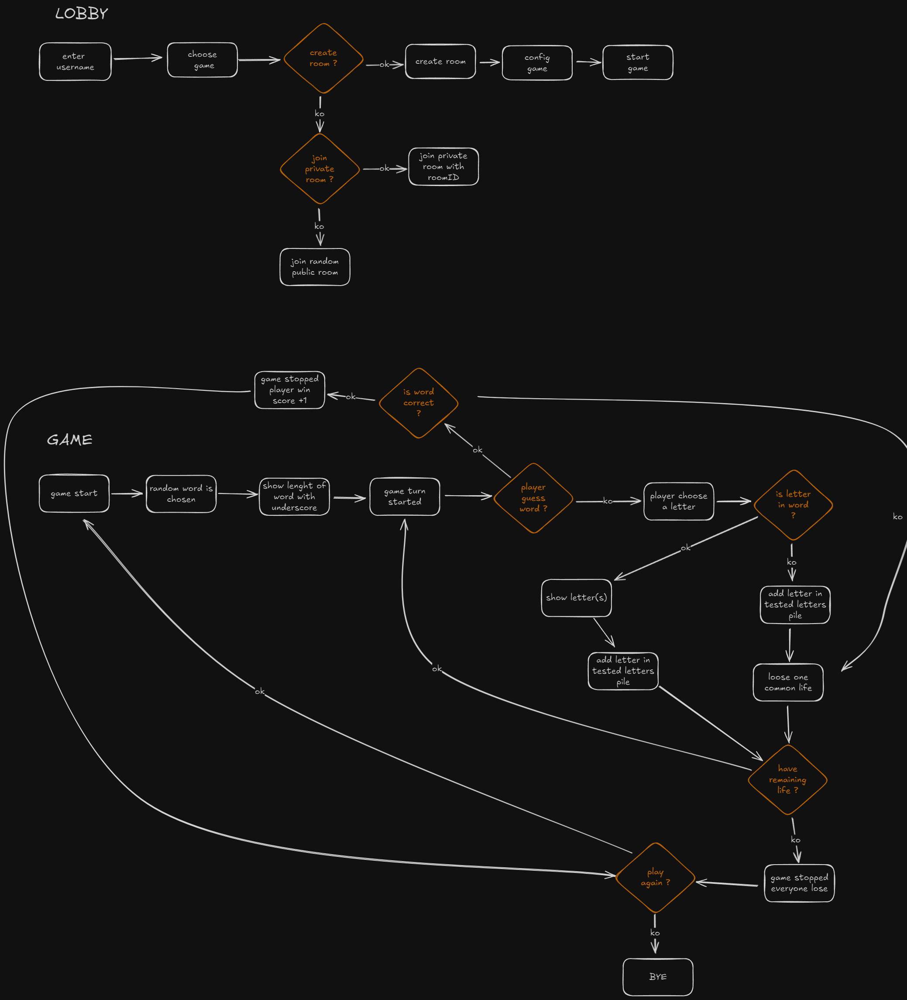
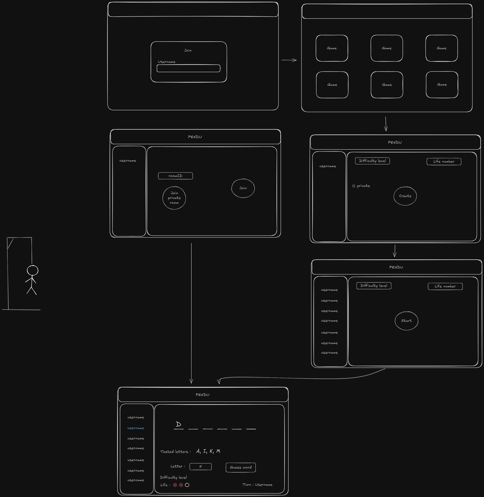

# 🪢 Pendu


## 📖 Overview

Pendu is a real-time multiplayer hangman game.

A player creates a game room and shares its code, friends join the room, and everyone tries to guess
the hidden word together while sharing a common pool of lives.

The project combines a React and TypeScript frontend with a NestJS backend. Both sides communicate
through WebSockets (Socket.IO) to keep every player's view synchronized in real time.

> 🚧 **This project is a work in progress.** The lobby is functional. The hangman game itself is the next step.

---

## 🧰 Tech Stack

### Frontend

* React 19
* TypeScript (strict mode)
* Vite
* Zustand
* Tailwind CSS 4
* React Router
* Zod
* Socket.IO client

### Backend

* NestJS 11
* TypeScript
* WebSockets (Socket.IO)
* class-validator / class-transformer
* Jest

---

## 🚀 Quick Start

### Backend

```bash
cd backend
npm install
npm run start:dev
```

The backend runs on:

```bash
http://localhost:3000
```

### Frontend

```bash
cd frontend
npm install
npm run dev
```

The frontend runs on:

```bash
http://localhost:5173
```

Open the app in two browser tabs to try it with several players.

---

## 🚀 Features

### ✅ Available

* Join with a username, validated on the client (Zod) and on the server (class-validator)
* Create a game room with a 6-character code, copyable in one click
* Join a room with its code, with an error message when the room does not exist
* Real-time lobby: player list, host indicator 👑 and local player highlighting
* Host transfer when the host leaves, and automatic cleanup of empty rooms
* Protected routes: the menu and lobby require a username
* End-to-end typed Socket.IO events between client and server

### 🔜 In progress

* Game settings (difficulty, number of lives) sent to the server
* Game flow: random word, turn-based play, guessing a letter or the whole word
* Shared lives, scoring and replay

---

## 🏗️ Project Structure

```text
backend/src/
├── hangman/
│   ├── dto/
│   ├── rooms/
│   ├── hangman.gateway.ts
│   └── hangman.socket.types.ts
├── app.module.ts
└── main.ts

frontend/src/
├── components/
│   ├── lobby/
│   └── ui/
├── pages/
├── socket/
├── store/
└── types/
```

### Structure Overview

#### Backend

* hangman/ – Game module: WebSocket gateway, rooms and validation
* rooms/ – In-memory room management (create, join, leave)
* dto/ – Validation of the data sent by the client
* hangman.gateway.ts – WebSocket events handled by the server
* hangman.socket.types.ts – Typed events shared between client and server

#### Frontend

* components/ – Reusable UI and lobby components
* pages/ – Home, menu and lobby views
* socket/ – Socket.IO client and typed events
* store/ – Zustand store holding the connection and room state
* types/ – Shared TypeScript types

---

## 🔄 Real-time Architecture

The application follows a client-server architecture based on WebSockets.

* The username is sent during the WebSocket handshake and validated by the server before the connection is accepted.
* Clients emit events (`create_room`, `join_room`) and receive a typed acknowledgement (`isOk` + room or error code).
* The server broadcasts `room_updated` to every player of a room whenever it changes.
* The Zustand store keeps the frontend state in sync with the server.

```text
React component
        ↓
Zustand store
        ↓
Socket.IO client  ⇄  NestJS WebSocket gateway
                            ↓
                      Rooms service
```

---

## 🎨 Design

The game was designed before being coded: the workflow and the wireframes are available in [`assets/`](assets/).

<details>
<summary>Game workflow (lobby and game flow)</summary>


</details>

<details>
<summary>Wireframes</summary>


</details>

---

## 📊 Project Status

The project is under active development.

---

## 🔮 Possible Next Steps

This list is likely to evolve as new ideas come up during development.

* Complete game flow (word guessing, shared lives, scoring, replay)
* Public and private rooms, and joining a random public room
* Let a player choose the word for the others to guess
* Deploy the application

---

## 📝 Notes

This project was built to explore real-time multiplayer development with WebSockets, from the
design phase (workflow and wireframes) to implementation.

The project emphasizes:

* Real-time communication with Socket.IO
* NestJS modular architecture
* Validation of untrusted client data
* End-to-end typing between frontend and backend
* State management with Zustand
